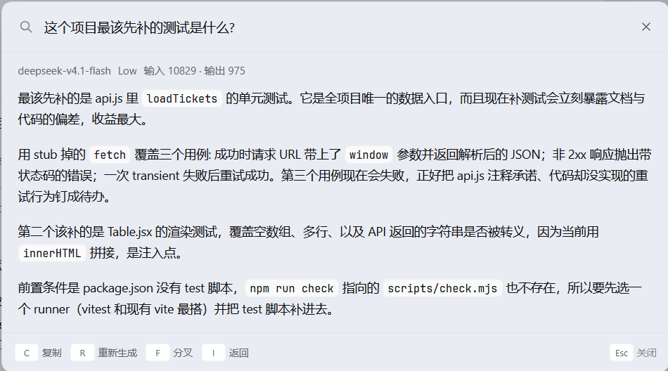

English | [中文](https://github.com/AK47are/dsh-quick-switcher/blob/main/README.md)

Quick switcher turns one input box into the search surface for the whole DSH session: jump between sessions and workspaces, open or create a workspace from a directory path, run any application command, refill the prompt box from your history, open a main panel, preview workspace files, recover archived sessions, and ask a side question that never enters the main conversation. It is keyboard first, and every mode can be switched off in Settings.


## Modes

Each mode is a list behind the same input box, and a trigger character at the start switches the list:

| Trigger | Mode | What it lists |
|---|---|---|
| none | Sessions | unarchived top-level sessions by title, workspace, path or session ID |
| `+` | Workspaces | workspaces by title or path, with the visible session count |
| `=` | Workspace path | subdirectories of a directory; Enter opens an existing workspace, or registers the directory and opens a new session |
| `>` | Commands | every editable DSH application command, most recent first |
| `!` | History | prompts you sent and answers you gave to question cards |
| `#` | Main panels | Plugins, Automation tasks and any other full-page panel |
| `@` | Files | files under the current session working directory |
| `?`, `？`, `﹖`, `︖` | Side question | side-question records; the text after the mark is the question |
| `~`, `～` | Archive | archived top-level sessions; Enter unarchives and opens, Shift+Enter only unarchives |

The side-question trigger also works at the end of the input, so `what changed?` asks a question while `@file?` still filters files. The other triggers only count at the very start; the archive trigger also accepts the fullwidth `～`.

Shift+Enter on a workspace row enters the `=` mode with that workspace's parent directory; the path stays editable, Tab enters a subdirectory, and Enter registers it and opens a new session.

## Install

DSH 0.2.2 or newer is required, and only the Web surface is supported.

The npm package is not published yet, so install from source for now.

From source:

```
git clone https://github.com/AK47are/dsh-quick-switcher.git
cd dsh-quick-switcher
npm install
```

`npm install` builds `client.js` and `host.js`. Install this directory as a local bundle in the current profile and refresh the page; run `npm run build` again after pulling changes.

The repository also publishes its own market index:

1. Open Settings, then the Plugins page and its Discover tab
2. Add the index `https://raw.githubusercontent.com/AK47are/dsh-quick-switcher/main/market/index.json`
3. Install `dsh-quick-switcher`, whose source in the index is a commit-pinned git URL; pnpm stops at `prepare`, so allow the pending build scripts when the plugin manager lists them and retry

## Use

Press Ctrl+Shift+K to open the panel, type to filter, move with the arrow keys, Enter opens the selection and Esc closes. The shortcut can be changed in Edit shortcuts under "Open quick switcher".

- The first row is always the previous session, so Enter right after opening jumps back
- Tab on a workspace row fills its full title into the input without opening the scope; press Enter or type the space to open it
- Shift+Enter on a workspace row enters the workspace-path mode with its parent directory; a missing directory is created first
- Type `~` to list archived sessions; Enter unarchives and opens, Shift+Enter only unarchives
- The capsule on the right of the first nine rows shows the platform's jump hint: Alt + 1 to Alt + 9 on Windows, and ⌥ 1 to ⌥ 9 on macOS; press the matching combination to run that row
- The first visible row always carries Alt + 1 (⌥ 1 on macOS), and rows past the ninth have no jump hint
- Every mode with an entry command registers "Quick switcher: <mode>", unbound by default
- Settings can switch each mode on or off, and choose the mode a plain open lands on


## Side question

Type `?` or `？` and the question, then press Enter. The answer streams into the list and uses the same Markdown renderer as the session panel, so tables, task lists, math and code highlighting match the main conversation. When the model returns reasoning, a collapsed thinking block appears above the answer, previewing the latest completed paragraph's first line and opening to the full reasoning.



- While the main session runs, the question carries the current step and its generating text; when idle it carries the persisted history
- The thinking block appears only when the model actually returns reasoning; the default lowest effort may be `off`, in which case there is nothing to show
- Thinking never travels with copy or fork: `C` copies only the answer, and `F` writes only the question and answer into the new session
- The model defaults to the current session model at the lowest reasoning effort; both can be fixed in Settings, and regenerating reads them again
- Closing the panel or refreshing aborts generation and keeps the received answer and thinking, marked as stopped; records live in browser local storage and survive a refresh
- Regenerating clears the answer and thinking, reads the model, level and attachment switch from the current settings, and reads the pending card currently on screen; a fork carries only the question and answer
- Record storage in Settings defaults to 1 MB and takes any size in MB; the readout shows the space in use and about how many side questions fit, including an estimate before the first record; clearing local records takes two clicks
- In the detail view, `i` or a click on the locked question box returns to the list, `C` copies, `R` regenerates, `F` forks and `S` stops

## Privacy

Apart from the model request a side question makes, the plugin sends nothing.

- Settings, mode switches, the default mode and session access times live in browser local storage
- Side-question records live in browser local storage; Settings can cap or clear them. A side question never enters the DSH session log, and only an explicit fork writes the question and answer into a new session
- Asking or regenerating a side question sends the conversation the model can see, its tool calls and the running step to the selected provider; images and files ride along by default and can be turned off in Settings
- The side-question host endpoints are internal to the local DSH host and are not a public API
- Workspace-path directory reads and directory creation go through local host endpoints; they touch only this machine and send nothing
- The plugin has no telemetry or analytics

## Limits

- DSH Web only; there is no TUI surface
- Side question needs a configured model provider
- Several features read DSH internals, so a DSH release that renames them can break a mode until it is updated
- Archived sessions never appear in the default and workspace lists, only in the `~` archive mode; blank drafts and subagent sessions never appear in any list; and browser-local state does not follow you to another browser
- Two DSH windows write their own record snapshots, so the later write replaces the earlier one; a refresh interrupts the streaming side question, which can only be reopened as stopped

## Documentation

Every project document is AI-generated and lives under `.agents/docs/`: the full behavior reference is the [usage guide](https://github.com/AK47are/dsh-quick-switcher/blob/main/.agents/docs/使用指南.en.md), the module API for other plugins is the [extension guide](https://github.com/AK47are/dsh-quick-switcher/blob/main/.agents/docs/扩展指南.en.md), and each hard decision is recorded in the [ADR index](https://github.com/AK47are/dsh-quick-switcher/blob/main/.agents/docs/adr/索引.md).

## License

MIT. This is an unofficial plugin and is not affiliated with DeepSeek.
