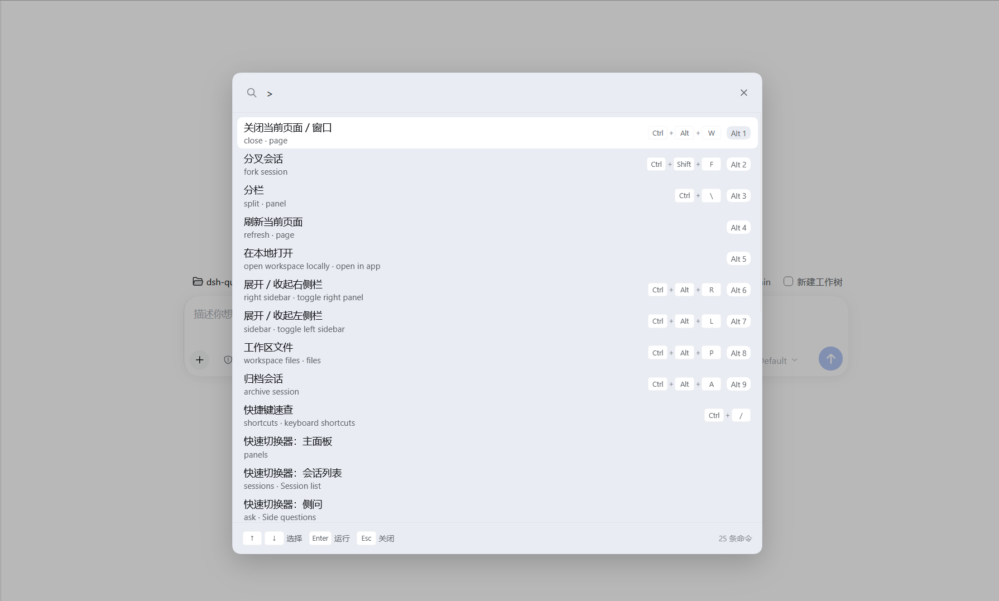
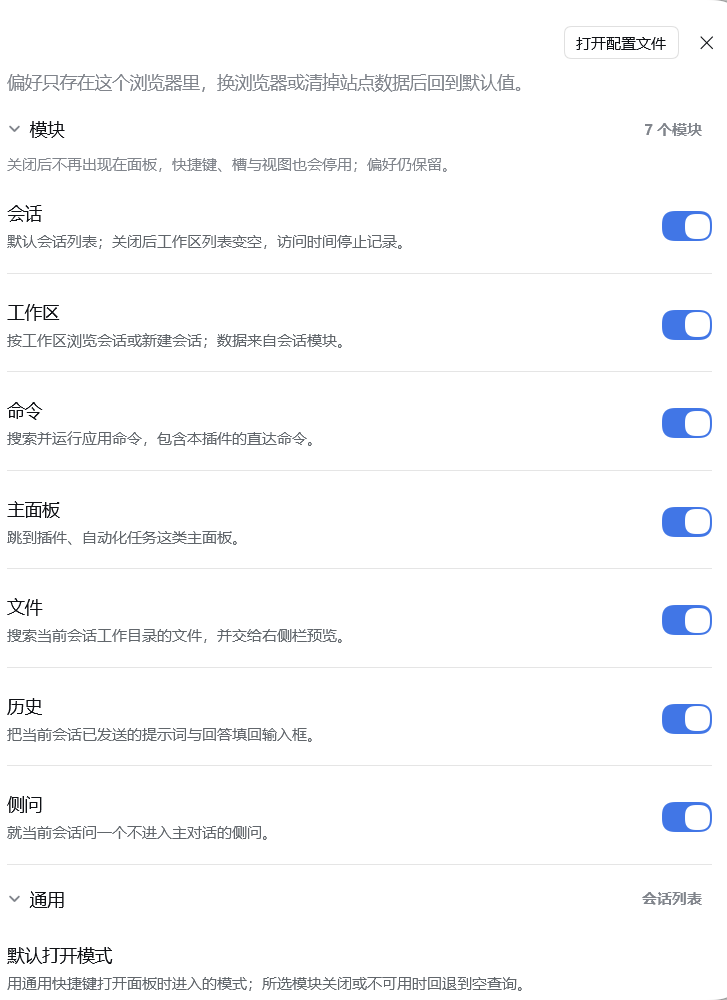

English | [中文](https://github.com/AK47are/dsh-quick-switcher/blob/main/README.md)

Quick switcher turns one input box into the search surface for the whole DSH session: jump between sessions and workspaces, run any application command, refill the prompt box from your history, open a main panel, preview workspace files, and ask a side question that never enters the main conversation. It is keyboard first, and every mode can be switched off in Settings.



## Modes

Each mode is a list behind the same input box, and a trigger character at the start switches the list:

| Trigger | Mode | What it lists |
|---|---|---|
| none | Sessions | unarchived top-level sessions by title, workspace, path or session ID |
| `+` | Workspaces | workspaces by title or path, with the visible session count |
| `>` | Commands | every editable DSH application command, most recent first |
| `!` | History | prompts you sent and answers you gave to question cards |
| `#` | Main panels | Plugins, Automation tasks and any other full-page panel |
| `@` | Files | files under the current session working directory |
| `?`, `？`, `﹖`, `︖` | Side question | side-question records; the text after the mark is the question |

The side-question trigger also works at the end of the input, so `what changed?` asks a question while `@file?` still filters files. The other triggers only count at the very start.

## Install

DSH 0.2.2 or newer is required, and only the Web surface is supported.

From the plugin market:

1. Open Settings, then the Plugins page and its Discover tab
2. Add the index `https://raw.githubusercontent.com/AK47are/dsh-quick-switcher/main/market/index.json`
3. Install `dsh-quick-switcher`, enable it, then refresh the page

From npm, by package name in the plugin manager, or:

```
dsh plugin --profile web add dsh-quick-switcher
```

The npm package ships both built entries, so installing runs no build script. Restart `dsh web` after a command-line install.

From source:

```
git clone https://github.com/AK47are/dsh-quick-switcher.git
cd dsh-quick-switcher
npm install
```

Then install the directory as a local bundle and refresh. A linked install does not run the prepare script, so run `npm run build` after pulling changes.

## Use

Press Ctrl+Shift+K to open the panel, type to filter, move with the arrow keys, Enter opens the selection and Esc closes. The shortcut can be changed in Edit shortcuts under "Open quick switcher".

- The first row is always the previous session, so Enter right after opening jumps back
- Alt+1 to Alt+9 run the matching visible row; on macOS Alt is Option
- The first visible row always carries Alt 1, and rows past the ninth have no number
- Every mode with an entry command registers "Quick switcher: <mode>", unbound by default
- Settings can switch each mode on or off, and choose the mode a plain open lands on



## Side question

Type `?` or `？` and the question, then press Enter. The answer streams into the list and uses the same Markdown renderer as the session panel, so tables, task lists, math and code highlighting match the main conversation.


- While the main session runs, the question carries the current step and its generating text; when idle it carries the persisted history
- The model defaults to the current session model at the lowest reasoning effort; both can be fixed in Settings
- Closing the panel aborts generation and keeps the received answer, marked as stopped
- In the detail view, `i` returns to the list, `C` copies, `R` regenerates, `F` forks and `S` stops

## Privacy

Apart from the model request a side question makes, the plugin sends nothing.

- Settings, mode switches, the default mode and session access times live in browser local storage
- Side-question records live in memory only and are lost on refresh
- A side question sends the conversation the model can see, its tool calls and the running step to the selected provider; images and files ride along by default and can be turned off in Settings
- The side-question host endpoints are internal to the local DSH host and are not a public API
- The plugin has no telemetry or analytics

## Limits

- DSH Web only; there is no TUI surface
- Side question needs a configured model provider
- Several features read DSH internals, so a DSH release that renames them can break a mode until it is updated
- Archives, blank drafts and subagent sessions never appear, and browser-local state does not follow you to another browser

## Documentation

Every project document is AI-generated and lives under `.agents/docs/`: the full behavior reference is the [usage guide](https://github.com/AK47are/dsh-quick-switcher/blob/main/.agents/docs/使用指南.en.md), the module API for other plugins is the [extension guide](https://github.com/AK47are/dsh-quick-switcher/blob/main/.agents/docs/扩展指南.en.md), and each hard decision is recorded in the [ADR index](https://github.com/AK47are/dsh-quick-switcher/blob/main/.agents/docs/adr/索引.md).

## License

MIT. This is an unofficial plugin and is not affiliated with DeepSeek.
