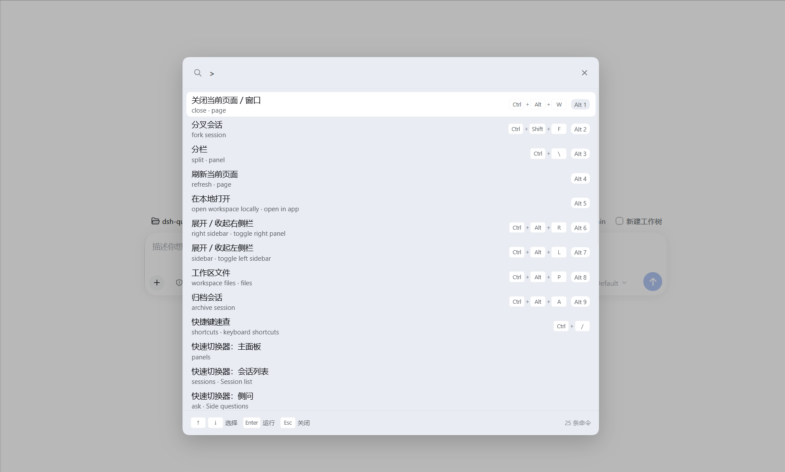
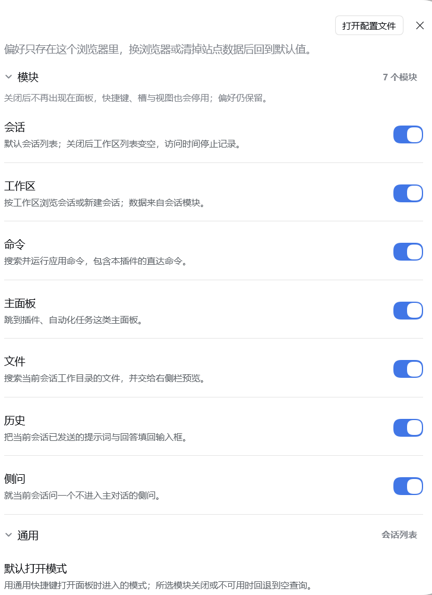
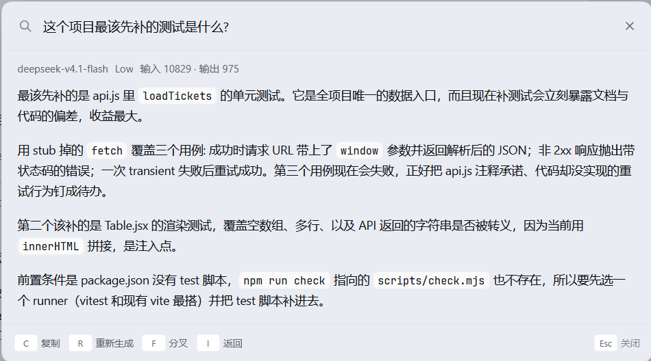

中文 | [English](https://github.com/AK47are/dsh-quick-switcher/blob/main/README.en.md)

快速切换器把 DSH 会话里的一个输入框变成统一搜索入口：在会话与工作区之间跳转、运行任意应用命令、把历史提示词填回输入框、跳到主面板、预览工作区文件，还能就当前会话问一个不进入主对话的侧问。整个流程以键盘为主，每个模式都能在设置里关掉。



## 模式

每个模式都是同一个输入框后面的一份列表，输入框开头的触发符决定当前看哪一份：

| 触发符 | 模式 | 列出什么 |
|---|---|---|
| 无 | 会话 | 未归档的顶层会话，按标题、工作区、路径或会话 ID 匹配 |
| `+` | 工作区 | 工作区，按标题或路径匹配，并显示可见会话数 |
| `>` | 命令 | DSH 里可编辑的应用命令，最近执行的在前 |
| `!` | 输入历史 | 你发过的提示词，以及你在提问卡里给出的回答 |
| `#` | 主面板 | 插件、自动化任务与其他整页界面 |
| `@` | 文件 | 当前会话工作目录下的文件 |
| `?`、`？`、`﹖`、`︖` | 侧问 | 侧问记录；触发符后面的文字就是问题 |

侧问的触发符也认结尾，所以 `改了什么?` 会发问，而 `@file?` 仍在过滤文件。其余触发符只在输入框最前面生效。

## 安装

需要 DSH 0.2.2 或更新版本，且只支持 Web 端。

npm 包尚未发布，目前从源码安装。

从源码安装：

```
git clone https://github.com/AK47are/dsh-quick-switcher.git
cd dsh-quick-switcher
npm install
```

`npm install` 会生成 `client.js` 与 `host.js`。把本目录作为本地 bundle 装进当前 profile，刷新页面即可使用；更新源码后重新跑一次 `npm run build`。

也可以从项目自带的市场索引安装：

1. 打开设置，进入插件页的 Discover 标签页
2. 添加索引 `https://raw.githubusercontent.com/AK47are/dsh-quick-switcher/main/market/index.json`
3. 安装 `dsh-quick-switcher`，索引的安装源是钉住 commit 的 git 地址，pnpm 会拦下 `prepare`，插件管理器列出待允许的构建脚本时点允许并重试

## 使用

按 Ctrl+Shift+K 打开面板，输入即过滤，方向键移动，Enter 打开选中项，Esc 关闭。快捷键可以在「编辑快捷键」里的「打开快速切换器」修改。

- 第一行固定是上个会话，打开面板后直接回车就能切回去
- 前九行右侧的胶囊显示当前平台的直达提示：Windows 为 `Alt + 1` 到 `Alt + 9`，macOS 为 `⌥ 1` 到 `⌥ 9`；按对应组合执行该行
- 第一行总是 `Alt + 1`（macOS 为 `⌥ 1`），第九行之后不显示直达提示
- 每个带入口的模式都会注册「快速切换器：<模式>」，默认不绑键
- 设置里可以逐个开关模式，并指定直接打开时落在哪个模式



## 侧问

输入 `?` 或 `？` 再输入问题，回车即可。答案在列表区流式显示，并交给会话面板同一个 Markdown 渲染器，因此表格、任务列表、公式与代码高亮都与主对话一致。模型返回推理时，答案上方会出现一个默认收起的思考块，标题行随流式显示最新完成段落的首行，展开后是完整的思考过程。



- 主会话运行中时，问题会带上当前步骤与正在生成的正文；空闲时带上已落盘的历史
- 思考块只在模型实际返回推理时出现；默认最低档可能是 `off`，这时不会产生思考，也就没有这个块
- 思考不会被复制或分叉带走：`C` 只复制答案，`F` 只把问题与答案写进新会话
- 默认跟随当前会话的模型，推理等级取最低档；两者都可以在设置里固定，重新生成时按当前设置重读
- 关闭面板或刷新页面会中止生成，已经收到的答案与思考保留并标为已中止；记录存在浏览器本地，刷新后仍在
- 重新生成会清空答案与思考，按当前设置重读模型、档位与附件开关，读取当前的待处理卡片正文；分叉只带问题与答案，不带卡片正文与思考
- 设置里的「记录容量」默认 1 MB，可按 MB 改；读数显示已用空间与大约能存多少条侧问，没有记录时也会给预估；清空本地记录要按两下
- 详情里 `i` 或点击锁定的问题框返回列表，`C` 复制，`R` 重新生成，`F` 分叉，`S` 停止

## 隐私

除了侧问触发的那次模型请求，插件不发送任何东西。

- 设置、模式开关、默认模式与访问时间都存在浏览器本地
- 侧问记录存在浏览器本地，可在设置里限制容量或清空；侧问本身不写 DSH 会话日志，只有你主动分叉时才会把问题与答案写进新会话
- 发问与重新生成会把模型可见的对话、工具调用与运行中的现场发给所选供应商；图片与文件默认随请求携带，可以在设置里关掉
- 侧问的宿主端点属于本地 DSH 宿主内部，不对外开放
- 插件没有自己的遥测或统计

## 限制

- 只支持 DSH Web，没有 TUI 版本
- 侧问需要已配置的模型供应商
- 多个功能读取 DSH 的内部接口，DSH 改名后对应模式会失效，直到插件跟进
- 已归档、空白草稿与子智能体会话不出现，浏览器本地状态也不会跟着你换到另一个浏览器
- 两个 DSH 窗口各写各的侧问记录，后写的那次覆盖先写的；刷新会中断正在流式的那条侧问，只能以已中止回看

## 文档

这些文档都由 AI 生成，统一放在 `.agents/docs/` 下：完整行为参考是[使用指南](https://github.com/AK47are/dsh-quick-switcher/blob/main/.agents/docs/使用指南.md)，给其他插件用的模块接口是[扩展指南](https://github.com/AK47are/dsh-quick-switcher/blob/main/.agents/docs/扩展指南.md)，每个难以回退的决定记录在 [ADR 索引](https://github.com/AK47are/dsh-quick-switcher/blob/main/.agents/docs/adr/索引.md)。

## 许可证

MIT。这是非官方插件，与 DeepSeek 没有隶属关系。
